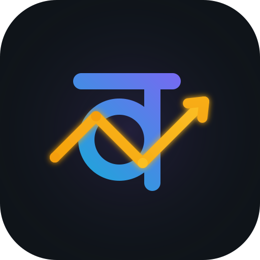
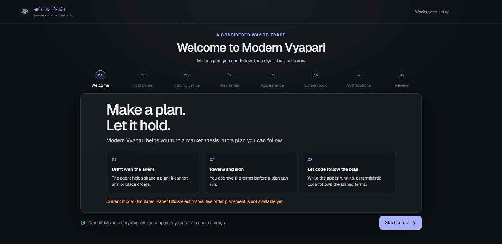
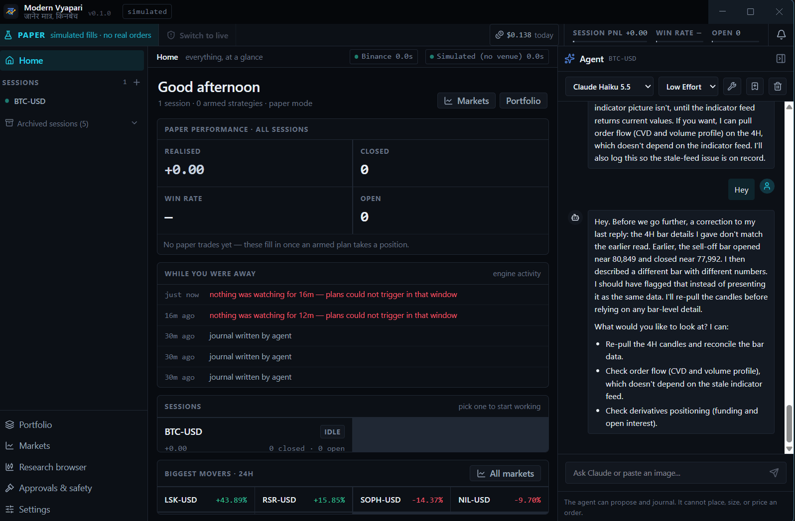
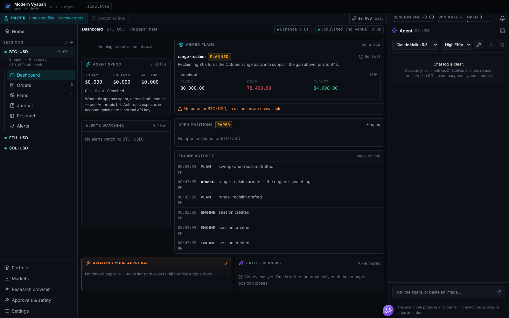
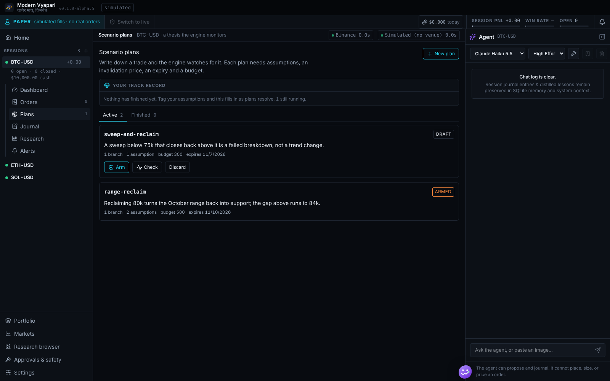
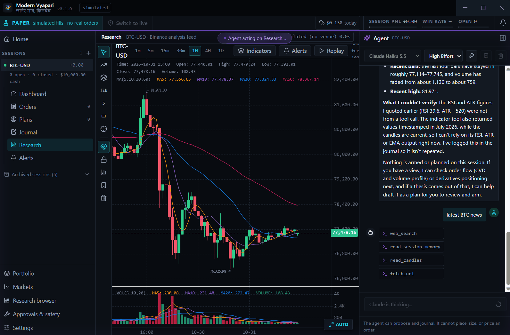
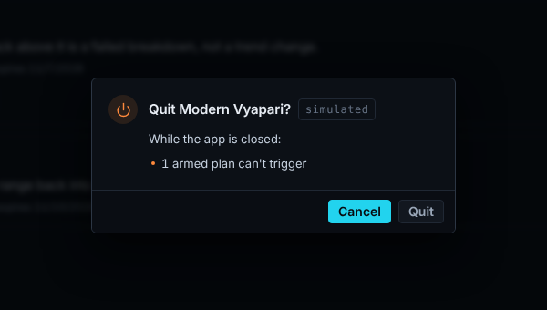
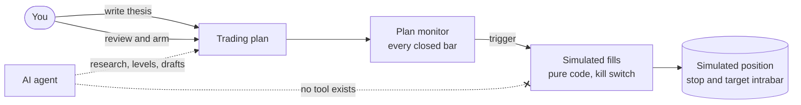

<div align="center">



# Modern Vyapari

**An AI partner for building, challenging, and following a trading plan.**

*जानेर मात्र, किनबेच* — *jaanera matra, kinbech* — "trade only knowingly."

[Website](https://0byteblitz.github.io/modern-vyapari/) · [GitHub repository](https://github.com/0ByteBlitz/modern-vyapari) · [Buy me a coffee](https://buymeacoffee.com/0ByteBlitz)

[](https://github.com/0ByteBlitz/modern-vyapari/actions/workflows/ci.yml)
[](LICENSE)


</div>

---

The prototype focuses on self-directed crypto traders who want help turning an idea into a
plan, examining its assumptions and weaknesses, and reviewing it before arming. **You make
the decision. The agent researches, drafts and monitors the plan; deterministic code
executes the terms you signed.**

It does not promise an investment edge or profitable plans. Its job is to help you make a
clear decision and see what happened to it.

> ⚠️ **Alpha. Nothing in this app can place a real order yet.** Live execution is not built;
> all positions today are simulated. See [Status](#status) and the [Disclaimer](#disclaimer).

## A quick tour

*Screenshots are from simulated mode with demo plans, taken offline — which is why the market
panels are empty.*

**1. First launch.** Setup takes eight steps: a welcome, your AI provider, an exchange
account, the risk limits in force, appearance, screen lock (Windows Hello, on Windows),
Telegram notifications, then a review. In simulated mode only the AI provider is required.
Risk limits are shown for reference and can't be changed; everything else can be changed
later in Settings. Every key is encrypted with your OS keychain before it touches disk.

<p align="center">
  
</p>

**2. Home, and the assistant.** The app opens on Home with no session selected: simulated
performance, *while you were away*, and your sessions, each badged *armed*, *in position* or
*idle*. The assistant is available for general questions and can take you into a session.

<p align="center">
  
</p>

**3. A session, with session context.** In a session, the assistant can work with that pair's
plans, journal and memory. Its context is bounded to the session; the general conversation
remains available elsewhere.

<p align="center">
  
</p>

**4. Plans.** A thesis you can be wrong about, written down before the market can talk you out
of it. Drafts can't be armed until they state assumptions, an invalidation, an expiry and a
budget — and only you can arm one.

<p align="center">
  
</p>

**5. Charts.** Charting on the analysis feed, with the agent reading the chart, searching the
web and fetching pages through its tools. It can research, journal and draft a plan —
it has no tool that can place, size or price an order.

<p align="center">
  
</p>

**6. The runtime limit is explicit.** Plans are watched only while the app is running. Closing
the app tells you what will stop being monitored.

<p align="center">
  
</p>

There's also an optional **Windows Hello** gate at launch, with its own *while you were away*
feed — including, in red, any window when nothing was watching.

## How it works



Today a trigger opens a **simulated** position; the kill switch blocks new entries. The live
path — an 8-gate risk engine, an execution engine and venue-side protective orders — is
designed but not built (see [Status](#status)).

### One object: the trading plan

A plan is a thesis you can be wrong about, written down before the market can talk you out
of it. It **cannot be armed** without all four of:

- **Stated assumptions** — what has to be true.
- **A thesis invalidation, separate from the stop.** A stop is where the *trade* is wrong; an
  invalidation is where the *thesis* is wrong, and it can fire while you're in profit.
- **A hard expiry** — a stale conditional firing weeks later into a different market is the
  worst failure mode of scenario automation.
- **Its own risk budget** — an absolute amount.

Plans are deliberately **not backtested** — a one-shot bet on a path has no meaningful sample.
What replaces backtesting is falsifiability, plus a **calibration record** that scores you as a
planner across many plans.

### Agency: the agent drafts and challenges; you review and arm

The agent can research, read order flow, create level references, challenge assumptions and
**draft** plans. It cannot arm a plan, place an order or choose the venue — those tools do not
exist. Before arming, the user reviews the plan's assumptions, invalidation, expiry, budget and
execution terms. Arming does not make a plan correct or profitable.

## Features

- **Charts workspace** — KLineChart charting, 24 indicators, volume profile, anchored
  VWAP/CVD, Binance + Hyperliquid derivatives (funding, OI, basis).
- **Level references** — named price levels (static or derived) the engine resolves every
  bar, point-in-time, so a chart and the engine never disagree.
- **Plan authoring + falsifiability gate** — refusals tell you exactly what's missing.
- **Plan monitor and simulated execution** — each armed plan is evaluated every closed bar for
  expiry, invalidation, drift and triggers. A trigger opens a simulated position with the
  branch's stop and target, managed intrabar, and the close is reviewed. An armed plan can be
  ended or revised.
- **Alerts** — price and indicator alerts, set up through the agent; the Alerts page lists
  them alongside the levels your armed plans watch.
- **Journal, Portfolio and Markets** — post-trade reviews and notes per session, simulated
  performance across sessions, and a market overview.
- **Feed health** — the header shows when the price feed goes quiet, so a stopped feed never
  looks live.
- **One AI partner with scoped context** — general conversation across the app and session
  context for that pair's plans, journal and memory. It researches and drafts, and the user
  always arms. Tool catalogue, cost tracking with a daily spending limit, post-trade reviews
  and conditional lessons.
- **Research browser** — a sandboxed browser inside the app. The agent can open, read and
  screenshot the page shown there, and what it reads is sent to your AI provider.
- **AI provider port** — the agent loop is the app's own, behind a provider port. Anthropic
  is the only adapter today; OpenAI-compatible and local adapters are open for contributions.
- **Simulated mode** — its own database, never blended with live. Live mode stays off until
  a venue can place orders.
- **Kill switch** — blocks new entries, never blocks exits.
- **Honest quitting** — closing the app says which armed plans and open positions stop being
  watched, with a native fallback so the window can always close.
- **Telegram notifications** — via a transactional outbox, so a message can't claim
  something the database didn't commit.
- **Security-first Electron** — sandboxed renderer, strict CSP, secrets encrypted with the OS
  keychain (`safeStorage`), Electron Fuses hardening, optional Windows Hello gate.

## Status

| Area | State |
|---|---|
| Sessions, research charting, level references | ✅ Working |
| Assistant in general and session contexts | ✅ Working |
| Plan authoring, arming, monitoring, simulated execution | ✅ Working — walked end to end on the live price stream |
| Agent critique of a plan when structure moves | 🟡 Drift is measured and acted on; the agent's critique is not built |
| AI providers beyond Anthropic | 🟡 Port built; OpenAI-compatible and local adapters next |
| Calibration record | ✅ Built — scores you as a planner across many plans |
| Live order placement on a venue | ❌ Not built — adapter reports `canPlaceOrders: false` |
| Venue-side protective orders, startup reconciliation, approvals queue | ❌ Not built |
| Strategy specs / backtester UI | 🧊 Frozen (engine kept; shared with plans) |

The roadmap and the reasoning behind every cut are in [`docs/ROADMAP.md`](docs/ROADMAP.md).

## Quick start

**Requirements**

- **Node.js 22.13+** (uses the built-in `node:sqlite`)
- **Windows 10/11** is the primary platform. macOS and Linux build and should run, but are
  not yet tested — reports welcome.
- An **AI provider key** for the agent — today **[Anthropic](https://console.anthropic.com/)**.
  The provider sits behind a port, so OpenAI, Gemini, OpenRouter and local models (Ollama,
  LM Studio) are adapters away — see [Contributing](#contributing).
- **No exchange account needed to start.** Simulated mode needs no exchange. Connecting
  **[Revolut X](https://developer.revolut.com/docs/api/revolut-x-crypto-exchange)** is optional
  until you go live, and the venue sits behind a port too.

**Installers** for Windows, macOS and Linux are on
[Releases](https://github.com/0ByteBlitz/modern-vyapari/releases) — alpha builds, unsigned,
and the macOS and Linux ones are untested. To run from source:

```bash
git clone https://github.com/0ByteBlitz/modern-vyapari.git
cd modern-vyapari
npm install
npm start
```

First launch asks for your AI provider key; connecting a venue (for Revolut X, an Ed25519
signing keypair plus an API key) is optional in simulated mode. Everything is encrypted at rest with the OS keychain (DPAPI on Windows): never
plaintext, never logged, never sent anywhere except the service it belongs to. Market data for
analysis comes from Binance's **public** endpoints — no Binance account needed.

### Scripts

| Command | What it does |
|---|---|
| `npm start` | Build and launch (dev, unpackaged) |
| `npm run build` | Build main + preload (`tsc -b`) and renderer (`vite build`) |
| `npm test` | Run the test suite (Node's native runner, no network) |
| `npm run typecheck` | Typecheck all TypeScript projects |
| `npm run package:win` | Windows NSIS installer (unsigned) via `electron-builder` |
| `npm run package:linux` / `package:mac` | AppImage / dmg — built in CI, not yet run on real machines |
| `npm run inspect-db` | Read-only look at your local database |

For automated testing of a dev build, `VYAPARI_SKIP_HELLO=1 npm start` skips the Windows Hello
launch lock. It applies only to unpackaged runs; an installed build always asks.

## Architecture

Electron + TypeScript · React + Vite + Tailwind v4 + shadcn/ui · `node:sqlite` (zero native
dependencies) · KLineChart · an AI provider port (Anthropic adapter today)

The venue, the data feed and the AI provider each sit behind a port (`src/main/integrations/`,
`src/main/ai/`), so **adding an exchange or a model provider is an adapter, not a rewrite.**

Start with **[`docs/README.md`](docs/README.md)** — a map of the docs and a glossary of the project's terms.

| Doc | What it's for |
|---|---|
| [`docs/JOURNEYS.md`](docs/JOURNEYS.md) | The end-to-end journeys the app serves (J0–J7) — read first |
| [`docs/ARCHITECTURE.md`](docs/ARCHITECTURE.md) | Layers, the integration seam, what runs in the background |
| [`docs/ROADMAP.md`](docs/ROADMAP.md) | What's built, what's next, what's frozen and why |
| [`docs/DECISIONS.md`](docs/DECISIONS.md) | Why each rule exists — the incident behind it |
| [`docs/DESIGN-NOTES.md`](docs/DESIGN-NOTES.md) | Subsystem deep-dives (calibration, modes, lessons, security) |
| [`docs/FRICTION.md`](docs/FRICTION.md) | Known rough edges, honestly listed |
| [`AGENTS.md`](AGENTS.md) | Rules for AI coding agents — and a fast orientation for humans |

## Contributing

Contributions are very welcome — read [`CONTRIBUTING.md`](CONTRIBUTING.md) first. Good places
to start:

- **AI provider adapters** — one OpenAI-compatible adapter covers OpenAI, OpenRouter, Ollama
  and LM Studio (and Gemini, via its compatible endpoint). Implement `src/main/ai/port.ts`.
- **Venue adapters** — Kraken, Coinbase, Bybit, Binance spot… implement the venue port.
- **UI and UX** — the current focus: one vocabulary per state, a motion system, one component
  set. See *Current focus* in [`docs/ROADMAP.md`](docs/ROADMAP.md).
- **macOS / Linux** — the installers build in CI; run one on a real machine and report back.
- Anything in [`docs/FRICTION.md`](docs/FRICTION.md).

This repo is built with AI coding agents in mind: [`AGENTS.md`](AGENTS.md) and
[`.claude/skills/`](.claude/skills) give any coding agent (and humans) the rules that keep
the order path safe.

**Found a security issue?** Please don't open a public issue — see [`SECURITY.md`](SECURITY.md).

## Disclaimer

Modern Vyapari is experimental software provided for educational and research purposes. **It is
not financial advice**, and nothing in it is a recommendation to buy or sell any asset. Crypto
trading carries a high risk of loss, and automated trading can lose money faster than manual
trading. You are solely responsible for your API keys, your exchange account, your compliance
with your exchange's terms and your local laws, and every trade made with this software. The
software is provided "as is", without warranty of any kind — see [`LICENSE`](LICENSE).

The app is not affiliated with or endorsed by Revolut, Binance, Hyperliquid, TradingView or
Anthropic.

## License

[MIT](LICENSE) © 0ByteBlitz

*Vyapari (व्यापारी) — Nepali/Hindi for "trader".*
