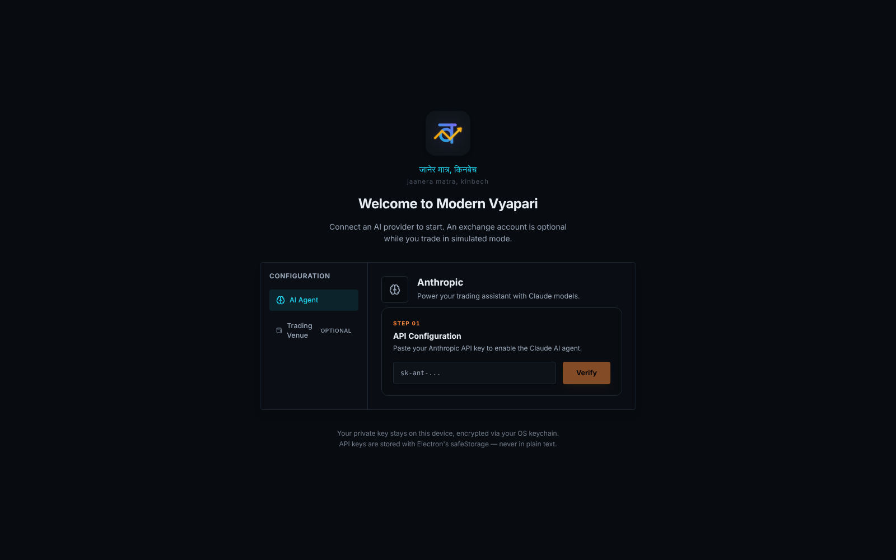
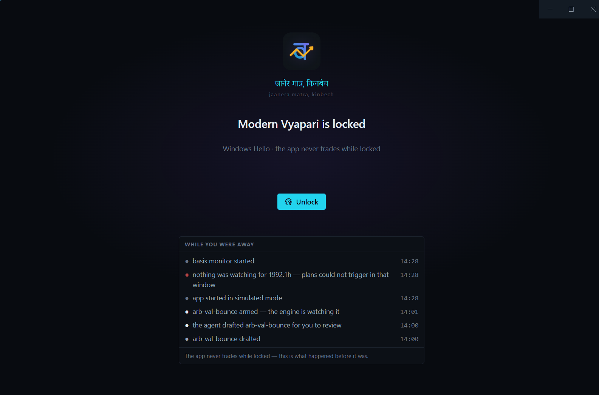
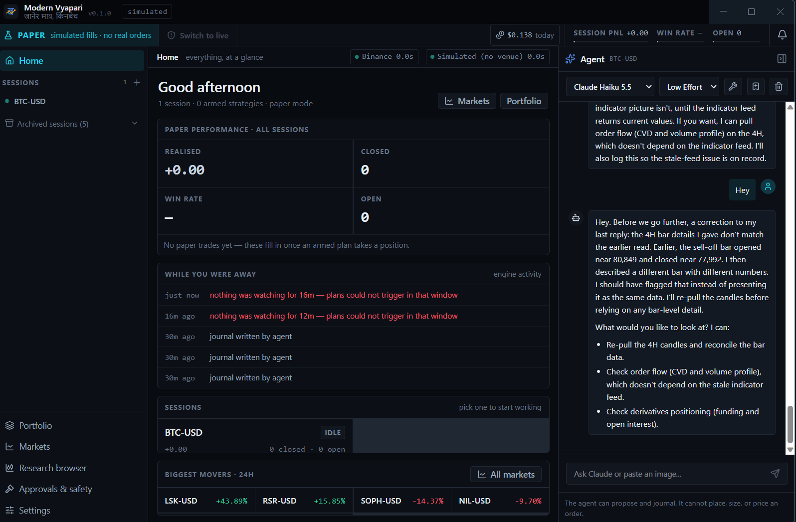
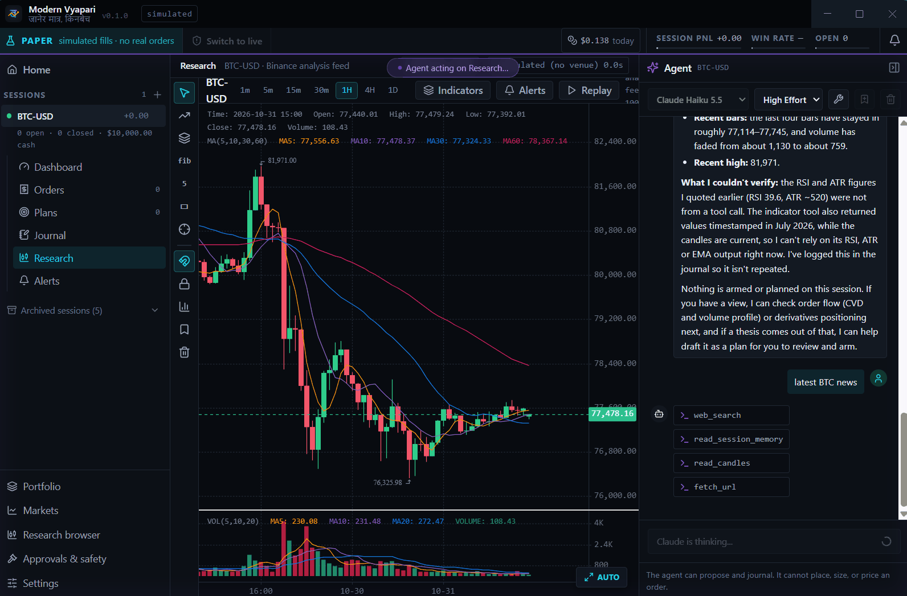

<div align="center">


# Modern Vyapari

**An AI trading partner that keeps the AI out of the order path.**

*जानेर मात्र, किनबेच* — *jaanera matra, kinbech* — "trade only knowingly."

[](https://github.com/0ByteBlitz/modern-vyapari/actions/workflows/ci.yml)
[](LICENSE)


</div>

---

Most AI trading projects ask *"can a model find the trade?"* Modern Vyapari starts from a
different problem: **most traders lose not for lack of ideas but because they don't stick
to their plan.** So the app's job is to take you out of the moment of temptation.

**You author a thesis. The agent helps you sharpen it and watches the market. Deterministic
code executes exactly what you signed — and nothing else.**

> ⚠️ **Alpha. Nothing in this app can place a real order yet.** Live execution is not built;
> all positions today are simulated (paper). See [Status](#status) and the [Disclaimer](#disclaimer).

## A quick tour

**1. First launch.** Generate a signing keypair, connect the venue, add your Anthropic key.
Every key is encrypted with your OS keychain before it touches disk.

<p align="center">
  
</p>

**2. Locked until you unlock.** An optional Windows Hello gate. *While you were away* shows
what the engine did — and, in red, any window when nothing was watching, because a plan
cannot trigger while the app is closed.

<p align="center">
  
</p>

**3. Home.** Paper performance across sessions, engine activity, and the day's biggest movers.
The agent sits in a drawer on every screen — and corrects itself when its data doesn't add up.

<p align="center">
  
</p>

**4. Research.** Charting on the analysis feed, with the agent reading the chart, searching the
web and fetching pages through its tools. It can research, journal and draft a plan —
it has no tool that can place, size or price an order.

<p align="center">
  
</p>

## How it works


### One object: the trading plan

A plan is a thesis you can be wrong about, written down before the market can talk you out
of it. It **cannot be armed** without all four of:

- **Stated assumptions** — what has to be true.
- **A thesis invalidation, separate from the stop.** A stop is where the *trade* is wrong; an
  invalidation is where the *thesis* is wrong, and it can fire while you're in profit.
- **A hard expiry** — a stale conditional firing weeks later into a different market is the
  worst failure mode of scenario automation.
- **Its own risk budget** — an absolute amount.

Plans are deliberately **not backtested** — a one-shot bet on a path has no meaningful sample.
What replaces backtesting is falsifiability, plus a **calibration record** that scores you as a
planner across many plans.

### Agency: the agent drafts, you sign, code executes

This is structural, not a setting. The agent can research, read order flow, create level
references and **draft** plans. It cannot arm a plan, place an order or choose the venue —
**those tools do not exist**, and a test asserts they never appear. A tool that does not exist
can't be reached by a jailbreak, a prompt injection from a web page, or a refactor that
forgets a check.

## How it compares

| | Autonomous multi-agent frameworks | **Modern Vyapari** |
|---|---|---|
| Who decides a trade | LLM agents debate and decide | **You**, at signing time |
| AI in the order path | Yes | **Never** — pure-code risk + execution |
| Form | Python library / CLI for research | Desktop app for daily use |
| Validation | Backtests | Falsifiable plans + a calibration record |
| Prompt-injection blast radius | Can affect trade decisions | Capped by construction: no order tools |

Projects like [TradingAgents](https://github.com/TauricResearch/TradingAgents) explore how far
autonomous agents can go. Modern Vyapari explores the other end: how useful AI can be while
being structurally unable to lose your money on its own.

## Features

- **Research workspace** — KLineChart charting, 24 indicators, volume profile, anchored
  VWAP/CVD, Binance + Hyperliquid derivatives (funding, OI, basis).
- **Level references** — named price levels (static or derived) the engine resolves every
  bar, point-in-time, so a chart and the engine never disagree.
- **Plan authoring + falsifiability gate** — refusals tell you exactly what's missing.
- **Plan monitor** — each armed plan is evaluated every closed bar for expiry, invalidation,
  drift and triggers; protective stops/targets are managed intrabar.
- **Agentic chat (Claude)** — session-scoped tools, switchable tool catalogue, cost tracking,
  post-trade reviews and conditional lessons.
- **Simulated and live modes** — separate databases, never blended; simulated by default.
- **Kill switch** — blocks new entries, never blocks exits.
- **Telegram notifications** — via a transactional outbox, so a message can't claim
  something the database didn't commit.
- **Security-first Electron** — sandboxed renderer, strict CSP, secrets encrypted with the OS
  keychain (`safeStorage`), Electron Fuses hardening, optional Windows Hello gate.

## Status

| Area | State |
|---|---|
| Sessions, chat, research charting, level references | ✅ Working |
| Plan authoring, arming, monitoring, paper execution | ✅ Working (proven on seeded bars; live-stream verification wanted) |
| Calibration record | 🟡 Recording, few entries |
| Live order placement on a venue | ❌ Not built — adapter reports `canPlaceOrders: false` |
| Venue-side protective orders, startup reconciliation, approvals queue | ❌ Not built |
| Strategy specs / backtester UI | 🧊 Frozen (engine kept; shared with plans) |

The roadmap and the reasoning behind every cut are in [`docs/ROADMAP.md`](docs/ROADMAP.md).

## Quick start

**Requirements**

- **Node.js 22.13+** (uses the built-in `node:sqlite`)
- **Windows 10/11** is the primary platform. macOS and Linux build and should run, but are
  not yet tested — reports welcome.
- An **AI provider key** for the agent — today **[Anthropic](https://console.anthropic.com/)**.
  The provider sits behind a port, so OpenAI, Gemini, OpenRouter and local models (Ollama,
  LM Studio) are adapters away — see [Contributing](#contributing).
- **No exchange account needed to start.** Simulated mode trades on paper. Connecting
  **[Revolut X](https://developer.revolut.com/docs/api/revolut-x-crypto-exchange)** is optional
  until you go live, and the venue sits behind a port too.

```bash
git clone https://github.com/0ByteBlitz/modern-vyapari.git
cd modern-vyapari
npm install
npm start
```

First launch asks for your AI provider key; connecting a venue (for Revolut X, an Ed25519
signing keypair plus an API key) is optional in simulated mode. Everything is encrypted at rest with the OS keychain (DPAPI on Windows): never
plaintext, never logged, never sent anywhere except the service it belongs to. Market data for
analysis comes from Binance's **public** endpoints — no Binance account needed.

### Scripts

| Command | What it does |
|---|---|
| `npm start` | Build and launch (dev, unpackaged) |
| `npm run build` | Build main + preload (`tsc -b`) and renderer (`vite build`) |
| `npm test` | Run the test suite (Node's native runner, no network) |
| `npm run typecheck` | Typecheck all TypeScript projects |
| `npm run package:win` | Windows NSIS installer (unsigned) via `electron-builder` |
| `npm run inspect-db` | Read-only look at your local database |

## Architecture

Electron + TypeScript · React + Vite + Tailwind v4 + shadcn/ui · `node:sqlite` (zero native
dependencies) · KLineChart · `@anthropic-ai/sdk`

The venue and data feed sit behind a port (`src/main/integrations/`), so **adding an exchange
is an adapter, not a rewrite.** Start with [`docs/ARCHITECTURE.md`](docs/ARCHITECTURE.md).

Start with **[`docs/README.md`](docs/README.md)** — a map of the docs and a glossary of the project's terms.

| Doc | What it's for |
|---|---|
| [`docs/JOURNEYS.md`](docs/JOURNEYS.md) | The seven end-to-end journeys the app serves — read first |
| [`docs/ARCHITECTURE.md`](docs/ARCHITECTURE.md) | Layers, the integration seam, what runs in the background |
| [`docs/ROADMAP.md`](docs/ROADMAP.md) | What's built, what's next, what's frozen and why |
| [`docs/DECISIONS.md`](docs/DECISIONS.md) | Why each rule exists — the incident behind it |
| [`docs/DESIGN-NOTES.md`](docs/DESIGN-NOTES.md) | Subsystem deep-dives (calibration, modes, lessons, security) |
| [`docs/FRICTION.md`](docs/FRICTION.md) | Known rough edges, honestly listed |
| [`CLAUDE.md`](CLAUDE.md) | Rules for AI coding agents — and a fast orientation for humans |

## Contributing

Contributions are very welcome — read [`CONTRIBUTING.md`](CONTRIBUTING.md) first. Good places
to start:

- **AI provider adapters** — one OpenAI-compatible adapter covers OpenAI, OpenRouter, Ollama
  and LM Studio (and Gemini, via its compatible endpoint). Implement `src/main/ai/port.ts`.
- **Venue adapters** — Kraken, Coinbase, Bybit, Binance spot… implement the venue port.
- **macOS / Linux** — packaging targets and a test run.
- **Live-stream verification** — arm a paper plan on a USD pair and report what happens.
- Anything in [`docs/FRICTION.md`](docs/FRICTION.md).

This repo is built with AI coding agents in mind: [`CLAUDE.md`](CLAUDE.md) and
[`.claude/skills/`](.claude/skills) give Claude Code (and humans) the rules that keep the
order path safe.

**Found a security issue?** Please don't open a public issue — see [`SECURITY.md`](SECURITY.md).

## Disclaimer

Modern Vyapari is experimental software provided for educational and research purposes. **It is
not financial advice**, and nothing in it is a recommendation to buy or sell any asset. Crypto
trading carries a high risk of loss, and automated trading can lose money faster than manual
trading. You are solely responsible for your API keys, your exchange account, your compliance
with your exchange's terms and your local laws, and every trade made with this software. The
software is provided "as is", without warranty of any kind — see [`LICENSE`](LICENSE).

The app is not affiliated with or endorsed by Revolut, Binance, Hyperliquid, TradingView or
Anthropic.

## License

[MIT](LICENSE) © 0ByteBlitz

*Vyapari (व्यापारी) — Nepali/Hindi for "trader".*
