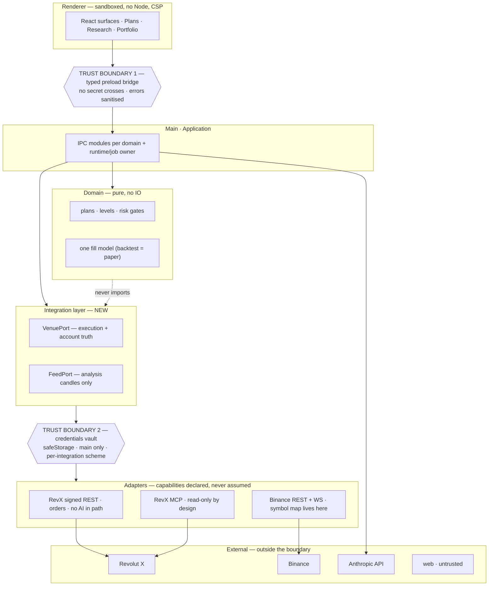

# Architecture — current state, and the integration seam

**Written 2026-07-31**, after an owner observation that the app "does not have
infrastructure or core backends that could handle the features it has — features
glued by frontend, without a strong system design behind them", and a follow-up
decision that integrations (venue and data feed) must become swappable.

This document exists so the next changes are made in the right place. It is a
*measurement* of the codebase, not an aspiration. Where it states a number, that
number was counted on the date above.

`CLAUDE.md` remains the operating rules and `docs/ROADMAP.md` the schedule. This
sits between them: what the system currently is, and what shape the next work
should take.

> **Status · 31 October 2026 — the measurements below are dated 31 July.** Since
> then:
>
> - `ipc.ts` is gone — **16 per-domain modules under `src/main/ipc/`**, guarded by
>   `ipc-surface.test.ts` and `lazy-require-paths.test.ts` (the second added after
>   ten lazy requires were left pointing at pre-split paths).
> - The venue layer exists: `integrations/venue/` (port, Revolut X and paper
>   adapters, registry, declared capabilities). Nothing outside it imports the
>   venue client.
> - Feed: symbol mapping and the feed's identity are consolidated in
>   `integrations/feed/symbols.ts`; `source = 'binance'` predicates **18 → 2**.
>   A feed port is not built.
> - Runtime: **six** `setInterval` sites across four files (scheduler ×3, basis
>   monitor, notify worker, monitor heartbeat), still no single owner — the design
>   in the second half of this file stands.
> - Secrets: both credential stores share one async cipher (`security/cipher.ts`).
> - **AI provider port** (`src/main/ai/`, 31 October): the agent loop, compaction
>   and reviews talk to a port; Anthropic is one adapter. Setup no longer needs an
>   exchange in simulated mode. See §11.
> - **Two conversations** (31 October): a global agent and per-session agents,
>   and the app opens with no session selected. See §12.

---

## 1. Layer assessment

| Layer | State | Evidence |
|---|---|---|
| **Domain** (pure rules) | **Strong** | `strategy-spec`, `trade-plan`, `backtester`, `risk-engine`, `volume-profile`, `anchored`, `level-reference` are pure functions with no IO. The fill model is shared between backtester and paper engine so they cannot drift. |
| **Persistence** | **Adequate** | 14 schema versions with real migrations; `withTransaction` added 2026-07-31. But queries are split between `db/queries.ts` and per-domain services with no consistent repository boundary. |
| **Application** | **Weak** | `ipc.ts` was 618 lines / 86 handlers at the time of writing; 630 / 87 after the venue work added `venue:info`. Still no grouping. It *is* the application layer, and it is a switchboard. **Unchanged by S2-9 — splitting it is S2-8.** |
| **Integration** | **Effectively absent** | There is no integration layer. Venue and feed are referred to by name, directly, from wherever they are needed. |

**The diagnosis in one line: the hard part is done and the plumbing around it is
missing.** That is an unusual and recoverable position — the correctness-critical
logic is isolated and tested. What is absent is the structure that carries it.

---

## 2. Integration coupling, measured

### Revolut X — moderate. Roughly 15 touch points.

- **3 main modules import the venue client**: `ipc.ts`, `data/basis-monitor.ts`
  and `exchange/revolutx-exchange.ts`. The client surface itself is tiny —
  `getBalances`, `getCandles`, `getTickers`, `getPairsConfig`.
  **Now 2, and both deliberate:** `integrations/venue/revolutx.ts` (the adapter,
  which is the point) and `exchange/revolutx-exchange.ts` (Sprint 4 scaffolding
  that is unreferenced and throws). **When S4-1 writes the order path it must go
  through the port, not around it** — that file is the one place the seam could
  be re-broken without anyone noticing.
  *(Corrected 2026-07-31: an earlier draft of this document said six modules and
  named `agent/chat.ts`, `agent/review.ts` and `browser/browserbase.ts` among
  them. Those three import `revx/**credentials**`, not the client — see the
  misplaced-vault finding below. The venue seam is smaller than first measured.)*
- **4 IPC channels carry the venue name into the renderer contract**:
  `revx:balances`, `revx:candles`, `revx:pairs`, `revx:tickers`. Renaming these
  is a breaking change to the preload bridge and 5 renderer files.
- **5 renderer files** mention RevX by name, mostly as labels — which is
  correct where it is an execution-truth annotation and wrong where it stands in
  for "the venue".
- **`revx/credentials.ts` is venue-shaped, not generic**: an Ed25519 keypair plus
  an API key. A venue authenticating by HMAC, OAuth, or a session token has
  nowhere to live.
- **The app-wide secret store lives inside a venue folder.** That same module
  also holds the **Anthropic** and **Browserbase** keys, which is why
  `agent/chat.ts`, `agent/review.ts` and `browser/browserbase.ts` import from
  `revx/`. Nothing is insecure about it — the encryption and the main-process
  confinement are unchanged — but it is a real structural error, and it has a
  direct consequence for this work: **when Revolut X moves behind an adapter,
  the vault must not move with it.** It belongs at `src/main/security/` (or
  `credentials/`), holding per-integration records, with the venue adapter as
  one client among several.

**Verdict: swappable in days.** The seam is small because execution barely
exists yet — Sprint 4 has not started, so there is little order-path code to
re-point. **This is the cheapest it will ever be to fix.**

### Binance — deep. This is the real problem, and the owner identified it correctly.

- **12 main modules** touch Binance.
- **6 hardcoded API URLs.**
- **18 SQL predicates containing `source = 'binance'`.** The identity of the
  analysis feed is a string literal repeated across the query layer.
- **5 independent symbol-translation sites**, each writing `${base}USDT` by
  hand (`indicators.ts` twice, `binance-ws.ts`, `binance-derivatives.ts`,
  `basis-monitor.ts`). Five copies of a mapping rule is five places for a venue
  with different conventions to break.
- Everything downstream resolves from that cache: levels, indicators,
  backtests, paper fills, CVD. **Changing the feed changes every number the app
  has ever produced.**

**Verdict: weeks, not days — and it carries real risk.** Schema v8 exists
because two paths disagreed about what a cached candle meant, and the fix was to
*purge* the contaminated history. A feed swap is that failure mode with the
safety off.

---

## 3. The distinction that decides the cost: swappable ≠ multi-venue

`ROADMAP.md` §1 defers multi-venue as "scope creep against a single-user tool".
That deferral should stand, and it does **not** conflict with what is being
asked for here, because these are different features:

- **Swappable (in scope):** one venue and one analysis feed at a time, chosen at
  setup, resolved through an interface rather than an import. No behaviour
  changes; the name stops being hardcoded.
- **Concurrent multi-venue (still deferred):** trading two venues at once,
  aggregating books, routing orders. This one is genuinely scope creep, and it
  also collides with the feed-role rule below.

**Everything in this document means the first.** If a change requires two feeds
to be live inside one computation, it has crossed into the second and is out of
scope.

### The constraint that survives any refactor

> **One feed per purpose, never mixed inside one computation** (CLAUDE.md, owner
> decision 2026-07-26). Analysis comes from the analysis feed; execution truth
> comes from the venue. A pluggable architecture must make this *easier* to
> enforce, not harder. If an adapter layer lets a caller accidentally blend two
> sources, the abstraction is wrong regardless of how clean it looks.

The existing `candles.source` column is the right primitive and is already
present. The mistake to avoid is treating source as metadata; it is part of a
candle's **identity**.

---

## 4. Target shape

```
src/main/integrations/
  venue/
    port.ts          VenuePort — balances, pairs, tickers, orders, fills, reconcile
    capabilities.ts  what an adapter declares it can do
    registry.ts      id → adapter; one active, chosen in settings
    revolutx.ts      the current client, moved behind the port
  feed/
    port.ts          MarketDataPort — candles, stream, symbol mapping
    capabilities.ts  aggressorSplit? maxHistory? intervals?
    registry.ts
    binance/         the current WS + REST, moved behind the port
```

Four rules for that layer, each earned from a bug this project already paid for:

1. **Capabilities are declared, never assumed.** An adapter states whether it
   publishes an aggressor split. CVD is then *unavailable and says so* on a feed
   that lacks it — rather than reading a missing field as `0`, which is exactly
   the `taker_buy_volume` trap already documented in schema v11.
2. **Symbol mapping belongs to the adapter.** One implementation of
   `BTC-USD → BTCUSDT`, not five. A venue quoting `BTC/USD` or `tBTCUSD` then
   costs one function, not a search.
3. **Source is identity, not metadata.** `candles.source` becomes the adapter
   id, the 18 scattered predicates collapse into one `feedScope()` helper, and
   **a computation may never span two sources.** Switching feeds does not
   migrate history — it starts a new cache, exactly as archiving starts a new
   session epoch.
4. **Credentials are per-integration, with a declared auth scheme.** Today's
   Ed25519-plus-API-key shape is Revolut X's, not "a venue's". The store already
   encrypts via `safeStorage`; what it lacks is a shape that admits a second
   scheme.

### Where the agentic angle actually lands

The owner's point — the app is agentic, so it should favour exchanges with good
AI support — is a **selection criterion and an adapter option**, not a change to
the execution path. Concretely:

- **An MCP server is a legitimate adapter transport** for *read* operations:
  balances, pairs, tickers, historical orders, reconciliation. A venue shipping
  a good MCP server is genuinely cheaper to integrate, and Revolut X already
  ships one.
- **It is not a substitute for the order path.** The hard rule stands: no AI
  call in order execution. An MCP *tool call* is deterministic code rather than
  a model call, so the rule is not violated by transport alone — but the
  practical point is stronger: Revolut X's own MCP server is read-only by
  design and cannot place orders. Execution stays signed REST.
- So the port should allow an adapter to be **partially implemented**: read via
  MCP, execute via REST, with capabilities making the split explicit rather than
  implicit.

---

## 5. What "architecturally correct" means for the next changes

Until the layer above exists, new code should at minimum:

- **Never import a venue or feed module from domain or agent code.** If
  `agent/review.ts` needs a price, it asks a service, not Revolut X.
- **Never write `source = 'binance'` in a new query.** Use the scope helper once
  it exists; until then, add it beside the existing ones so they can be found and
  replaced together.
- **Never translate a symbol inline.** Five copies is already four too many.
- **Keep domain modules pure.** This is the part that is working; it is worth
  protecting.
- **Keep the renderer free of wire formats.** `plans-page.tsx` currently builds
  `ConditionGroup` JSON by hand — that is the clearest instance of the
  "glued by frontend" problem and is scheduled as S2-8's second item.

---

## 6. Cost, honestly

| Work | Estimate | Risk |
|---|---|---|
| Venue port + Revolut X adapter behind it | ~1–2 days | Low. Little execution code exists yet. |
| Rename `revx:*` IPC → `venue:*` | ~half a day | Low, but touches 5 renderer files. |
| Credentials → per-integration with auth schemes | ~1 day | Low–medium; migration of existing stored keys needed. |
| Feed port + Binance adapter, symbol mapping consolidated | ~2 days | Medium. |
| Collapse 18 `source =` predicates into one scope | ~1 day | **Medium–high.** These sit under every number the app produces. |
| Split `ipc.ts`, runtime/job owner, outbound channel (S2-8) | ~2 days | Low. |

**Roughly a working week**, and it lands squarely on the serial chain
`references → plans → live` that §2 of the roadmap names as the binding
constraint. The owner has accepted that cost explicitly (2026-07-31). The
sequencing consequence is worth stating plainly: **Sprint 4 (live execution)
starts a week later**, and §4's launch gate — not the calendar — decides whether
real money trades on 30 August.

The counter-argument, which is why the decision is defensible: every one of
these seams gets *more* expensive once the order path exists, and Sprint 4 is
precisely when real money starts depending on them.

---

## 7. Recommended order

*(Status as of 2026-07-31 — items 1 and 2 are done and on `main`.)*

1. ~~**Venue port + adapter, and the IPC rename.**~~ **Done.** `integrations/venue/`
   holds the port, the Revolut X adapter and the registry; channels are
   `venue:*`; the renderer reads the venue's display name from the adapter.
2. ~~**Credentials with declared auth schemes.**~~ **Done.**
   `security/integration-secrets.ts`. The existing Revolut X keys are
   deliberately *not* migrated — see the module note.
3. **S2-8's remaining items** (frontend glue, `ipc.ts` split, runtime owner,
   outbound channel) — structure that makes the rest safe to do.
4. **Feed port and symbol mapping.**
5. **The `source =` collapse, last and on its own commit**, because it is the one
   that can silently change numbers. It wants a test asserting that a resolved
   level is identical before and after.

---

## 8. System design, with trust boundaries



The dotted edge is the rule that keeps the domain testable: **domain and agent
code never import an integration.** They ask the application layer, which asks a
port. Today `agent/chat.ts` and `agent/review.ts` violate this by importing the
Revolut X client directly.

---

## 9. Security analysis

### What this design improves

- **Credentials stop being one venue's shape.** Today the vault is an Ed25519
  keypair plus an API key — Revolut X's scheme. A second venue would either
  reuse those fields for something they do not mean, or bypass the vault. A
  per-integration record with a *declared* auth scheme removes both options.
- **One choke point for outbound calls.** Six hardcoded Binance URLs and a
  venue client imported from six modules means there is no single place to
  enforce a host allowlist, a timeout, or redaction. A port gives one.
- **The vault gets its own home, out of a venue folder.** Today the app-wide
  secret store was `revx/credentials.ts`, so the agent and browser modules
  imported their API keys from a *venue* path. **Done 2026-07-31** — it now
  lives at `security/credentials.ts`. That is a structural error rather than a
  vulnerability — nothing about the encryption or main-process confinement
  changes — but moving Revolut X behind an adapter without first moving the
  vault out would drag every consumer of the Anthropic key into the venue
  adapter's dependency graph. Extract the vault **first**.
  *(An earlier draft of this section claimed `agent/chat.ts` imports the
  exchange client and framed it as a security posture item. That was wrong: it
  imports credentials. The corrected version is the structural point above.)*
- **The kill switch gets somewhere to live.** It is currently checked at
  `entryAllowed()`; a port is where "no new risk" can be enforced for every
  adapter, including the resting-order cancellation S4-5 needs.

### New risks this design introduces

1. **An adapter layer is an attack surface if it ever becomes dynamic.**
   Adapters must be **compiled in, never loaded at runtime** — no dynamic
   `require`, no user-supplied adapter path, no plugin directory. A pluggable
   venue that can execute arbitrary code with vault access is a credential
   stealer with a config file.
2. **MCP transport moves account data off the machine.** A remote MCP server
   sees balances, orders and fills. Rules: prefer a locally-run server;
   **never pass venue credentials to a third-party MCP host**; treat an MCP
   adapter's responses as untrusted input, exactly as web content is.
3. **A declared capability is a trust decision.** An adapter claiming to
   publish an aggressor split, but not really doing so, poisons CVD *silently* —
   the schema-v11 failure by another route. Capabilities must be validated at
   ingest, not believed: the existing `[0, volume]` check on `taker_buy_volume`
   is the right pattern and should be the rule for every declared capability.
4. **"Which venue is active" becomes a privileged setting.** Switching venue or
   feed must be a deliberate, audited, human action. **No agent tool may change
   it**, and no instruction found in web content or an MCP response may cause
   it. This is the same class as the kill switch: a control that decides where
   real money goes.
5. **A feed swap is a safety event, not just a correctness one.** Levels resolve
   from cached history; mixing two sources produces levels that no market ever
   printed, and a plan can *trigger an order* on one. Hence the rule in section 4:
   switching feeds starts a new cache rather than migrating history.

### What does not change, and must not

- **No AI call in the order path**, ever. An MCP tool call is deterministic
  code rather than a model call, so MCP-as-transport does not breach this — but
  execution stays signed REST regardless, because Revolut X's MCP server is
  read-only by design.
- Secrets stay main-process only, never cross IPC, never enter a log, a prompt,
  or the DB.
- Every live position carries a venue-side stop.
- The exchange remains the source of truth; startup reconciles against it.

---

## 10. Pros and cons of taking this on now

**For**

- **It is the cheapest it will ever be.** Sprint 4 has not written the order
  path. Every seam gets more expensive once real money depends on it.
- **Testability improves immediately.** A fake adapter makes end-to-end tests
  possible without a network, which the suite currently achieves only by
  flipping a global offline flag.
- **It fixes a real security posture item** — the agent layer's direct venue
  import — rather than only an aesthetic one.
- **The rules it encodes are ones already paid for in bugs** (one feed per
  purpose, unknown-is-not-zero, capabilities not assumptions). An abstraction
  that enforces them is worth more than the indirection costs.

**Against**

- **A port with one implementation is usually the wrong port.** You do not
  learn the seam until the second adapter exists. Expect to redesign parts of
  it when a real second venue lands — shape it around what *this app* needs,
  not around what Revolut X happens to offer.
- **Leaky abstraction risk is real in trading.** Venues differ in order types,
  fee models, precision rules and whether they support venue-side OCO. A
  lowest-common-denominator port could quietly *hide a safety feature* — for
  example a venue-side stop the app then emulates locally, which the plan
  explicitly forbids ("a local stop is not a stop if the app is closed").
  Capabilities must expose these differences rather than paper over them.
- **It costs roughly a working week on the binding serial chain**, so Sprint 4
  starts later and the launch gate rather than the calendar decides whether
  real money trades on 30 August.
- **The feed half carries genuine risk of silently changing numbers.** That is
  why section 7 puts the `source =` collapse last, alone, with a before/after test.

**The decision (owner, 2026-07-31) is to proceed.** The reasoning that makes it
defensible is the first "for" and the third "against" together: doing it now is
cheap and doing it later is not, provided the feed work is sequenced last and
treated as the dangerous half.


---

## 11. Vendor neutrality — the AI provider is swappable too

**Journey: J7, swap the venue, the feed or the AI provider.** The moment of
truth: someone without an Anthropic account — or without an exchange account —
installs the app, picks what they already have, and reaches Home. Before
31 October they could not: setup demanded Revolut X keys and the agent loop was
written against Anthropic's SDK, so either missing account was a dead end.

The same rule as §3 applies: **swappable, not multi-provider.** One AI provider
at a time, chosen in settings. Routing a single conversation across models is not
in scope.

### The port (`src/main/ai/port.ts`)

The agent loop is the app's, not the vendor's. `agent/chat.ts` runs the loop —
tool dispatch, retries, usage recording, compaction — and asks the provider for
exactly three things: complete a prompt, take one streamed step of a
conversation, and accept tool results. The conversation itself is **opaque**
(`AgentConversation`): each adapter keeps its own wire format inside it, so the
loop never sees a vendor's message shape and an adapter never has to round-trip
through a lowest-common-denominator one.

Each adapter declares its capabilities, and features degrade **by capability,
never by vendor name**:

| Capability | When false |
| --- | --- |
| `serverWebSearch` | The agent finds pages with the app's own `fetch_url`; A-3 adds app-side search. |
| `promptCaching` | Every step pays full input price; the stable/volatile system split is still sent. |
| `vision` | Chart screenshots are not attached; the agent reads levels as numbers. |
| `toolCalling: "basic"` | Typical of small local models. The loop still validates every tool call; nothing is trusted because the model emitted it. |

**The safety invariant does not move.** Tools belong to the app (`agent/tools.ts`,
`tool-registry.ts`), not the provider. An adapter translates the app's tool list;
it cannot add one. So whatever model is on the other end, there is still no
order, arming or venue tool — *the agent drafts, the owner signs, code executes*
holds by construction, not by trusting a vendor.

**Enforced:** `vendor-boundary.test.ts` fails if any file outside `src/main/ai/`
imports a model vendor's SDK. `agent-loop.test.ts` drives the loop against a fake
provider (text, tool round-trips, web-search rejection and retry, missing key);
every new adapter must pass it with a fake transport, so adapters are testable
without a key.

### One adapter covers four of the five requested providers (A-1)

OpenAI, OpenRouter, Ollama, LM Studio and Gemini all accept the OpenAI chat
completions format with tool calling, so the plan is **one** `openai-compatible`
adapter with a configurable base URL rather than five:

| Provider | Base URL | Key |
| --- | --- | --- |
| OpenAI | `https://api.openai.com/v1` | required |
| OpenRouter | `https://openrouter.ai/api/v1` | required |
| Google Gemini | `https://generativelanguage.googleapis.com/v1beta/openai/` | required |
| Ollama (local) | `http://localhost:11434/v1` | none |
| LM Studio (local) | `http://localhost:1234/v1` | none |

Gemini goes through its OpenAI-compatible endpoint rather than its native SDK —
one adapter fewer to keep correct, at the price of Gemini-only features the agent
does not use. Local servers declare `toolCalling: "basic"`, `promptCaching: false`
and `serverWebSearch: false`. They still honour `net-guard`'s offline switch,
like every other outbound call.

**Cost (A-5): unknown stays unknown.** An adapter that has no price for a model
records usage with cost `null`, and the UI says *unknown* — never `$0.00`, which
is a confident wrong number. Local models declare a true zero.

**Credentials:** per-provider keys go in `security/integration-secrets.ts` through the same
async cipher as every other secret, main-process only, crossing IPC as booleans
(`SetupStatus.ai.configured`). A base URL is not a secret and is stored as a
setting.

### Onboarding is venue-optional in simulated mode

`VenueReadPort.isConfigured()` and `SetupStatus.{mode, venue, ai, setupComplete}`
make setup complete when **an AI provider is configured and, in live mode only,
the venue is too**. Simulated mode runs on the paper venue, which needs nothing.
`isSetupComplete` is one exported function in `ipc/setup.ts`, tested in
`setup-status.test.ts`, and the renderer only reads its result — the rule exists
in one place.

### Still open

A-1 adapter, A-2 provider choice in Settings, A-3 app-side web search, A-5
per-provider cost; on the venue side V-1 connection forms rendered from the
declared auth spec, and V-2 venue choice in onboarding once a second adapter
exists. All in ROADMAP › *Vendor neutrality*. The feed port (§4) is unchanged.

---

## 12. Two conversations — the global agent and the session agent

**Journeys: J0 (the daily loop) and J1 (hunch → thesis).** The moment of truth:
the owner opens the app, asks the agent something, and never has to wonder which
pair it thinks they are talking about. Before 31 October the app restored the
last session on launch, so the agent drawer showed one pair's conversation
beside a Home page that said nothing was selected — the *armed vs. idle* kind of
ambiguity, applied to *which conversation am I in*.

**The rule: a session's chat exists only on that session's own surfaces**
(Dashboard, Orders, Plans, Journal, Research, Alerts — `shared/surfaces.ts`, one
definition for both bundles). Everywhere else the agent is the **general
conversation**. The rail and the toolbar's session figures follow the same rule.

| | Global agent | Session agent |
|---|---|---|
| Where | The mascot, lower-right, every surface (`agent-mascot.tsx`) | The drawer, on its session's surfaces (`chat-drawer.tsx`) |
| History | `general_chat_messages` (schema v21) | `chat_messages` for that session |
| Context | The sessions, with armed plans and open positions (`buildGeneralContext`) | The session's pair, plans, positions, journal, lessons |
| Tools | Only those that need no session; `SESSION_SCOPED_TOOLS` are not offered and are refused if called | The full catalogue |
| Navigation | May move the screen only between global surfaces | Only within its session's surfaces |

- **The selection is cleared at launch** (`clearSelectionForLaunch`); the previous
  one is kept as *last* and offered as one click back. Nothing in the runtime
  depends on the selection, so clearing it stops nothing.
- **Every chat event carries its conversation** (`ChatConversation`: a session
  id or `"general"`), and each panel ignores the others'. Two panels can be on
  screen at once, and a reply can outlive a session switch; before this, its tail
  landed in the next session's transcript.
- **The agent never switches what the owner is looking at between
  conversations.** It may suggest a session; opening one is the owner's click.
- **Neither form gains a tool.** The general conversation has fewer tools than a
  session's, not more; no order, arming or venue tool exists in either.

**Closing the app stops all of this.** A plan can only trigger while the app is
running, so the quit confirmation (`services/quit-guard.ts`, copy in
`shared/quit.ts`) says which armed plans and open positions stop being watched.
It is the app's own themed dialog, with the native box as a fallback whenever
the renderer is loading, crashed or slow to acknowledge — the window must always
be closable.

---

# What runs when nobody is typing

*Folded in from `docs/RUNTIME.md` on 2026-08-09 — the runtime **is** part of the
architecture, and a design for unbuilt work did not need a file of its own.*

**Written 2026-08-05.** Design for ROADMAP **S2-8's** "single runtime owner", and
the answer to the owner's question: *"lot of functionalities may have to have
background tasks running, since agent needs awareness most of the time. How
would we design a system?"*

Design agreed, **not yet built**. Nothing in this document describes current
behaviour except where it says so.

---

## The journey this serves

**J3 — the plan executes without me**, the spine. Everything here exists because
the owner's stated problem is not sticking to their plan, and the app's answer
is to keep working when they are not watching.

Its moment of truth is unchanged: **the plan did exactly what was written, and
the record says why.** A runtime that acts but cannot say why has only done half
of it.

---

## The trap this design exists to avoid

**You cannot put the agent in a loop.** A model running continuously is
expensive, non-reproducible and unreviewable — and it is the same failure the
owner already named on the strategy path: motion that costs tokens and produces
nothing. *"Awareness most of the time"* has to be assembled from something
cheaper than constant inference.

It is also forbidden where it matters. **No AI call may ever be in the
order-execution path** (`CLAUDE.md`, hard rule). A model deciding an entry at
3am cannot be reviewed, reproduced or tested, and "why did it buy there?" would
have no answer.

---

## Two tiers, and they must never blur

### Tier 1 — deterministic watchers. Always on, no AI.

Candle ingest, the plan monitor, alerts, drift, expiry, the heartbeat, feed
health, the basis sampler. Pure code: cheap, reproducible, testable, and safe in
the money path.

**These decide *when something has happened*.** They are the only tier allowed
to open or close a position.

### Tier 2 — agent jobs. Rare, event-triggered, bounded.

The agent wakes with **one specific question**, produces **one written
artifact** — a notification, a critique, a review, a distilled lesson — and goes
back to sleep. It never polls, never loops, and never decides money.

**The bridge between the tiers is a job queue.** Watchers emit facts; a registry
decides which facts deserve an agent call. That separation is the whole design:
it is what lets the app be continuously *aware* without being continuously
*inferring*.

---

## Where the agent's judgment actually goes

The owner's flow said the agent should *"look at the market situation, and enter
if it thinks the market at that point is favourable."* The intent is right — a
stale trigger should not fire mechanically into a market that has changed — but
an AI call at the moment of entry is the one thing that cannot happen.

**So the judgment moves earlier: the agent authors the conditions, the engine
judges the moment.**

Everything the agent would "look at" when the alert fires is written *into the
plan* during the conversation, as conditions the engine evaluates: CVD not
diverging from price, holding above the anchored VWAP, spread inside a bound,
volume confirming, funding not hostile. Then:

- trigger fires → engine checks the confirming conditions → enters only if they hold;
- a **confirmation window**: if confirmation does not arrive within N bars, the
  trigger **lapses** rather than firing late.

That is "is this still favourable?" — mechanised, deterministic, reproducible
and testable. The agent still supplies the judgment; the engine supplies the
timing. **Agentic without an unreviewable model call between the owner and their
money.**

The agent's job at trigger time is therefore *not* to decide. It is to write the
situation note that travels with the notification, so the owner opening their
phone reads why this fired and what the market looked like — not just that it
did.

---

## What every job must be, or the queue becomes a token drain

Each of these is a rule with a specific failure behind it.

| Rule | The failure it prevents |
|---|---|
| **Budgeted and cooled down** — one invalidation explanation per plan per day, not per bar | A choppy market alone empties the account. This is the owner's "wasting tokens" complaint arriving through a new door. |
| **Idempotent** — keyed on the event, not the tick | Two reviews of one trade, or a notification sent twice. `paper_positions.reviewed` is the existing pattern. |
| **Persisted, not in-memory timers** | The app is shut most of the time. A job that lives only in a `setInterval` silently means "only if the app happened to be open when it was due". |
| **Catch-up on boot** | The window between runs is where the interesting things happened. `reviewPendingPositions()` and the heartbeat gap already work this way. |
| **Failure-isolated** | A broken agent job must never disturb the engine that trades. `review.ts` already swallows and logs; this makes it the rule rather than one file's good manners. |
| **Enumerable** — what is running, when it last ran, what it cost | Today there are four scattered `setInterval` sites with no owner. You cannot pause, inspect or budget what you cannot list. |

---

## The jobs this product actually needs

| Tier-1 trigger | Tier-2 agent job | Status |
|---|---|---|
| Branch trigger fires | Situation note attached to the notification | not built |
| Thesis invalidated, or a level drifted out of tolerance | Explain it **in thesis terms**, propose an amendment (never apply one) | not built — J4 |
| Position closes | Review against the plan's assumptions | built (`review.ts`) |
| Every N closed trades | Distil lessons — scenario-tagged, shared across sessions | built per-session; cross-session owed |
| An assumption's condition breaks **before** the stop is hit | **Volunteer** — say so unprompted | not built; this is the partner test |
| Monitor gap detected at boot | Report the unwatched window | built (`monitor-heartbeat.ts`) |

The last row of the "not built" set is the one that turns a tool into a partner.
Nothing in the app currently says anything the owner did not ask for.

---

## What exists today, and what is wrong with it

Measured 2026-08-05:

- `services/scheduler.ts` — three jobs on three `setInterval`s (missed-alert
  watchdog 3m, equity snapshot 1h, feed watchdog 30s).
- `data/basis-monitor.ts` — its own `setInterval`, 60s.
- `paper/monitor-heartbeat.ts` — its own `setInterval`, 60s.
- `paper/paper-exchange.ts` — driven by the candle stream, not a timer. Calls the
  plan monitor directly, deliberately: **a second candle subscriber would race
  it**, and `EventEmitter` fan-out gives no ordering guarantee between listeners.
- `agent/review.ts` — a listener on position close, plus a startup catch-up.

**Four timer sites, no shared owner, nothing enumerable, nothing persisted, no
budget anywhere.** The pieces work; there is no system.

---

## The shape to build

**One `RuntimeOwner` in main.** It starts and stops everything, and it is the
only thing that owns a timer.

- **A `jobs` table**: `id`, `kind`, `key` (for idempotency), `due_at`,
  `attempts`, `status`, `payload`, `last_error`. Persisted, so a job survives the
  app being closed and runs on the next boot rather than being lost.
- **A registry of job kinds**, each declaring: its trigger, its cooldown, its
  budget, whether it calls the model, and whether it may write.
- **Tier-1 watchers stay exactly where they are.** They gain one thing: instead
  of acting directly, the ones that want an agent enqueue a job.
- **A single execution loop** that drains due jobs sequentially — never in
  parallel, because parallel model calls on one session would interleave writes
  to the same journal.
- **Settings › Diagnostics gains a runtime pane**: every job kind, last run,
  next due, failures, and model spend. If it cannot be seen it cannot be trusted.

**Ordering rule, carried over unchanged:** the bus carries *notifications of
things that already happened*, never a step in a sequence that decides money.
Execution stays direct calls (S2-7's rule, and the reason the plan monitor is
invoked from `handleCandle` rather than subscribing separately).

---

## The honest limit

**Nothing runs while the app is closed.** No design on one machine changes that.

- It is why the heartbeat records the gap rather than letting an unwatched window
  look identical to "nothing happened" — that distinction is the calibration
  record's integrity.
- It is why the hard rule says an open position's protective stop must rest **on
  the exchange**, not in here. A local stop is not a stop when the app is shut.

If continuous coverage becomes a requirement rather than a preference, the
options are a headless Windows task against the same database — with real care,
since two writers on one SQLite file is its own failure mode — or a server. The
cloud path was declined 2026-08-05 for a good reason: it means exporting a
private key the venue already knows to a machine the owner does not control.

---

## Open decisions

Neither should be settled by inference:

1. **Email / out-of-app notification.** The owner's flow depends on being told
   when they are away, and this is the only piece that **leaves the machine** —
   so it needs a credential and an explicit go-ahead. Currently parked in
   ROADMAP §5; if the flow above is the product, it moves into scope.
2. **Whether tier-2 jobs run in simulated mode.** They cost money in tokens
   whether the trade is real or not. Cheapest honest default: reviews and lessons
   yes (they are how the app learns), situation notes only in live mode.

